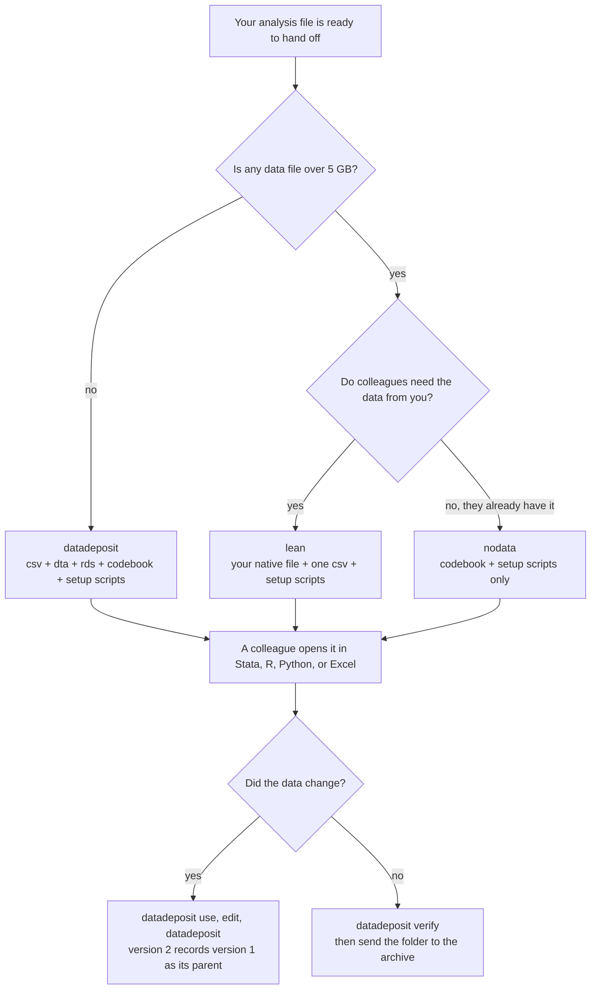

# datadeposit

**Prepare data, documentation, and code for your colleagues the way you would prepare them for a data archive. The same command works in Stata, R, and Python.**

`datadeposit` is for teams that work in more than one statistical language. One analyst
cleans a survey in Stata, a colleague models it in R, a partner organization reads it in
Python, and a program officer opens it in Excel. Each handoff usually loses something:
value labels, notes, the wording of the survey questions, or the precision of a number.

Data archives such as ICPSR and Harvard Dataverse solved this problem long ago. They
distribute each study as a folder with the data in plain text, a codebook, and setup
files that rebuild the labelled data in each statistical package. `datadeposit` writes
that kind of folder for you, so your colleagues and partners receive your analysis file
in the form an archive would give them. When the time comes to send the study to an
archive, the folder is already in the expected shape.

```stata
datadeposit, to(survey_deposit) title("Spring 2026 resident survey") replace
```
```r
datadeposit("survey.dta", to = "survey_deposit", title = "Spring 2026 resident survey", replace = TRUE)
```
```python
datadeposit("survey.dta", to="survey_deposit", title="Spring 2026 resident survey", replace=True)
```

The three versions write the same folder. The metadata tables, setup scripts, codebook,
and DDI file match byte for byte, and the data files match value for value. A test suite
compares the three on every change.

## Install

Install the version for the program you use. You do not need the other two, and the
people who receive a deposit do not need to install anything.

### Stata

```stata
net install datadeposit, from("https://raw.githubusercontent.com/ericabooth/datadeposit/main/") replace force
discard
which datadeposit
help datadeposit
```

`datadeposit` needs Stata 16 or later and no other community-contributed commands. The
package ships `datadeposit.pkg` and `stata.toc`, so Stata's installer copies the command
and its help file in one call. If `which datadeposit` prints a path and a version line,
the install worked.

### R

```r
install.packages("remotes")
remotes::install_github("ericabooth/datadeposit", subdir = "r")
library(datadeposit)
packageVersion("datadeposit")
```

The package needs R 4.1 or later. `subdir = "r"` tells R that the package is in the `r`
folder of the repository. These optional packages add features, and `datadeposit` tells
you when one would have helped:

```r
install.packages(c("haven", "writexl", "readxl"))
```

### Python

Run this in a terminal (macOS Terminal, Windows PowerShell, or the Anaconda Prompt):

```bash
python3 -m pip install "git+https://github.com/ericabooth/datadeposit.git#subdirectory=python"
```

Then check it:

```bash
python3 -c "import datadeposit; print(datadeposit.__version__)"
```

The package needs Python 3.9 or later and pandas, which `pip` installs for you. The line
above uses `git`. If your machine does not have `git`, this line downloads a zip file
and does the same job:

```bash
python3 -m pip install "https://github.com/ericabooth/datadeposit/archive/refs/heads/main.zip#subdirectory=python"
```

On Windows, type `python` in place of `python3`. To add the two optional helpers
(openpyxl for the Excel codebook, pyreadstat for SPSS files):

```bash
python3 -m pip install openpyxl pyreadstat
```

## Your first deposit

Each example below loads a small dataset, writes a deposit, and loads it back.

```stata
sysuse nlsw88, clear
datadeposit, to(nlsw88_deposit) title("NLSW 1988 extract")
datadeposit use nlsw88_deposit, clear
```
```r
library(datadeposit)
datadeposit(mtcars, to = "cars_deposit", title = "Motor Trend cars")
cars <- deposit_use("cars_deposit")
```
```python
import pandas as pd
from datadeposit import datadeposit, deposit_use

df = pd.DataFrame({"id": [1, 2, 3], "score": [3.5, 4.0, None]})
datadeposit(df, to="scores_deposit", name="scores", title="Test scores")
scores = deposit_use("scores_deposit")
```

The command prints a short receipt: where the folder is, which files it wrote, and
whether the data rebuilt from the csv matched the original.

## What a deposit holds

```
survey_deposit/
├── README.md                 how to open the data in Stata, R, Python, and Excel
├── MANIFEST.json             size and sha256 hash of every file
├── datapackage.json          Frictionless Data Package description
├── data/
│   ├── survey.csv            the portable copy: plain text, codes rather than labels
│   ├── survey.dta            for Stata
│   └── survey.rds            for R
├── metadata/
│   ├── survey_variables.csv      one row per variable: type, format, label
│   ├── survey_valuelabels.csv    every value label
│   ├── survey_chars.csv          notes and characteristics, including question text
│   ├── survey_dataset.csv        dataset label, size, sort order
│   ├── survey_summary.csv        statistics for each variable
│   └── survey_frequencies.csv    counts for every labelled variable
├── codebook/
│   ├── survey_codebook.md        codebook to read
│   ├── survey_codebook.xlsx      the same tables as Excel sheets
│   └── survey_ddi.xml            DDI Codebook 2.5, the archive standard
├── setup/
│   ├── survey_setup.do           rebuilds the labelled data in Stata
│   ├── survey_setup.R            rebuilds it in R
│   └── survey_setup.py           rebuilds it in Python
└── docs/                     the questionnaire or anything else you pass with include()
```

The metadata tables are plain csv files that Excel opens, and the setup scripts read
them when they run. A colleague who spots a typo in a label can correct it in the table
and rerun the script. Each setup script needs only its own language: base Stata 16, base
R, or Python with pandas. The person who receives the folder does not need `datadeposit`.

## When to use it



We find these situations come up most often:

- **Handing an analysis file to a colleague who uses another language.** They run one
  setup script and get your labels, value labels, notes, and question text.
- **Sending data to a partner or client.** The folder explains itself: the README says
  how to open the data, and the codebook documents every variable.
- **Closing out a project.** The deposit is a dated, hashed snapshot of the data and its
  documentation that a future team can open without the software you used.
- **Submitting to ICPSR, Dataverse, or a journal.** The csv, the DDI codebook, and the
  README are the materials those archives ask for.

## A deposit at the end of every script

We suggest you add a deposit line after the step that saves your analysis file. Each
rerun of the script then refreshes the copy your team shares.

```stata
* ... cleaning and merging ...
save "derived/survey_clean.dta", replace
datadeposit, to("share/survey_deposit") title("Resident survey, cleaned") ///
    authors("Eric A. Booth; Jane Analyst") license("CC-BY-4.0") onlarge(lean) replace
```

Give `to()` in a project script. Without it, the deposit goes to `<name>_deposit` in the
working directory, and the receipt prints the full path. The command does not write
beside the source file, because that folder is often a raw or cleaned data folder that
other scripts read.

`replace` removes the earlier deposit's files before writing, so a rerun does not leave
a stale copy beside a new one. It refuses to touch a folder that is not a deposit.
`onlarge(lean)` keeps the line working as the data grow, as the section on large files
explains. The R and Python versions take the same options, written `replace = TRUE` and
`on_large = "lean"`.

## Any data file, or a whole folder

`datadeposit` decides what a file is by reading its first bytes, so the file's name does
not have to be right. You can point it at one file, several files, or a folder.

```stata
datadeposit, files("responses.txt") to(responses_deposit)
datadeposit, folder("raw") pattern("*") to(raw_deposit)
```
```r
datadeposit("responses.txt", to = "responses_deposit")
datadeposit(folder = "raw", pattern = "*", to = "raw_deposit")
```
```python
datadeposit("responses.txt", to="responses_deposit")
datadeposit(folder="raw", pattern="*", to="raw_deposit")
```

| The file is | What happens |
|---|---|
| Delimited text with commas, tabs, pipes, or semicolons, whatever the extension (`.csv`, `.txt`, `.tsv`, `.dat`) | read as a table; a note names the delimiter |
| Semicolon-delimited with decimal commas (European exports) | read with the right decimals |
| Text in Latin-1, UTF-8 with a byte-order mark, or UTF-16 | read and converted to UTF-8, with a note |
| A gzipped text table (`.csv.gz`) | read as a table |
| A Stata, Excel, or SPSS file with the wrong extension | recognized and read as what it is |
| A column of ZIP codes or IDs that start with 0 | kept as text, so `01234` stays `01234` |
| `NA`, `N/A`, `NaN`, `null`, or `.` in a numeric column | read as missing, with a note |
| Repeated or unusable column names | renamed (`id`, `id_2`); the original name stays in the csv and the codebook |
| Binary data named `.txt`, prose notes, an empty file, a table with ragged rows | refused, with the reason and the row at fault |
| Code and documents (`.do`, `.R`, `.py`, `.pdf`, `.md`) | skipped in a folder; pass them with `include()` to ship them in `docs/` |

In folder mode the command deposits every table it finds, lists each file it skipped with
the reason, and gives two files with the same stem (`a.csv` and `a.csv.gz`) distinct
names. Values that Stata cannot store are converted, and a note says so: infinite numbers
become missing, integers too long for a double become text, and times with a time zone
are converted to UTC.

## Large files

Before writing anything, `datadeposit` estimates the size of each data file. If one would
exceed 5 GB, the command stops and writes nothing, because a full deposit of a 40 GB
`.dta` would put a 40 GB csv and a 40 GB `.rds` beside it. The message lists your choices:

| Option | What you get |
|---|---|
| `lean` | your native file (`.dta` from Stata, `.rds` from R) plus one csv and all three setup scripts; colleagues build their own copy from the csv when they need it |
| `nodata` | the codebook, metadata, and setup scripts only, for when you share the data another way |
| `allowlarge` | every format anyway |
| `maxsize(#)` | a different limit, in GB |
| `onlarge(lean)` | switch to `lean` automatically instead of stopping |

`lean` is the middle choice for big files: one native copy, one portable copy, and
scripts instead of converted files. `MANIFEST.json` records which choice applied.
`nostats` skips the summary statistics and frequency tables, which saves time on files
of several gigabytes.

## Picking up a deposit and publishing changes

A deposit is a snapshot, and we suggest you never edit its files. An edit breaks the
hashes in `MANIFEST.json`, and anyone who already used the deposit could no longer
reproduce their results. To publish changed data, write a new deposit beside the old
one. ICPSR and Dataverse version datasets the same way: each version is complete, and
each names the version it came from.

```stata
datadeposit use "share/survey_deposit", clear
replace income = . if income < 0
datadeposit, changes("Negative incomes set to missing")
```

After `datadeposit use`, a deposit with no `to()` goes to `survey_deposit_v2` beside the
original and becomes version 2. Its `MANIFEST.json` records the parent's folder,
version, and hash under `derived_from`, and its README states what changed. The same
steps work across languages, so an R user can load a deposit that Stata wrote, change
it, and publish version 3:

```r
d <- deposit_use("share/survey_deposit_v2")
d$income[d$income > 1e6] <- NA
datadeposit(d, changes = "Incomes over 1 million set to missing")
```
```python
df = deposit_use("share/survey_deposit_v3")
df.loc[df["age"] < 18, "age"] = None
datadeposit(df, changes="Ages under 18 set to missing")
```

While a deposit is still a draft that nobody else has used, overwriting it with `replace`
is fine. [docs/workflows.md](docs/workflows.md) walks through each task in each language.

## What survives the trip

Survey files keep much of their documentation outside variable labels. `datadeposit`
brings all of it to R and Python:

- **Question text stored in characteristics**, such as `q1[question]`, including quotes,
  dollar signs, backticks, line breaks, and accented characters.
- **Notes** on variables and on the dataset.
- **Extended missing codes** such as `.d` "Don't know" and `.r` "Refused", with their
  labels. In R and Python the code is stored inside the missing value itself, so it stays
  with its row when you filter, sort, or merge. `haven::na_tag()` reads it in R, and
  `datadeposit.missing_codes()` reads it in Python.
- **Shared value label sets and label languages** (`label language`).
- **`svyset`, `xtset`, and similar settings**, which return when the data come back to Stata.
- **Exact numbers.** Doubles pass through the csv to the last binary digit, floats stay
  floats, and dates and datetimes are written as ISO text. Base R's csv reader is not
  exact for 17-digit numbers, so the R setup script checks and corrects each one.

You can confirm all of this for any deposit. `MANIFEST.json` lists a sha256 hash for
every file, and `datadeposit verify` rebuilds each dataset from its csv and compares it
with the deposit.

## Editing labels in Excel

`datadeposit codebook` writes the metadata, codebook, and setup scripts without data
copies. You can edit the variables table in Excel (labels, formats, value label sets),
add a `new_name` column to rename variables, or add a `drop` column to drop them. Then
you apply the edits to the data, much as `iecodebook apply` does:

```stata
datadeposit codebook, to(cb)
* edit cb/metadata/survey_variables.csv or cb/codebook/survey_codebook.xlsx
datadeposit apply using cb
```

In R and Python the same step is `deposit_apply(df, "cb")`.

## If something is missing on your machine

`datadeposit` finishes the deposit with what the machine has and tells you how to add
the rest.

| Situation | What you see | What to do |
|---|---|---|
| Stata or Python user without R | the deposit is written without the `.rds`, and a note explains why | nothing is required, because R users can run `setup/*_setup.R`; to get the `.rds`, install R from [cloud.r-project.org](https://cloud.r-project.org) or use `lean` |
| R is installed where Stata cannot find it | the same note | `rscript("C:/path/to/Rscript.exe")`, or set the environment variable `DATADEPOSIT_RSCRIPT` |
| Python without openpyxl, or R without writexl | no `_codebook.xlsx`; the csv tables and the Markdown codebook are complete | `python3 -m pip install openpyxl`, or `install.packages("writexl")` |
| The receiver's Python has no pandas | the setup script stops with the install command | `python3 -m pip install pandas` |
| The receiver has Stata 14 or 15 | `setup.do` says it needs Stata 16 | open `data/<name>.dta` directly; it holds the same data and labels |
| The receiver has Stata 13 or older | the same message, with the steps for old versions | import `data/<name>.csv` and take labels from the `metadata` tables, or ask the sender for an older `.dta` |
| The receiver has no statistical software | | open `data/<name>.csv` and `codebook/<name>_codebook.xlsx` in Excel |
| The deposit folder cannot be written | an error names the folder | choose another place with `to()` |
| A deposit was interrupted halfway | `use` and `verify` report that it did not finish | run `datadeposit` again with `replace` |

## How the three versions stay in sync

- **One specification.** [spec/DEPOSIT-SPEC.md](spec/DEPOSIT-SPEC.md) defines every file,
  column, and formatting rule. If an implementation disagrees with it, the implementation
  has a bug.
- **One copy of each setup script.** `spec/templates/` holds the three setup scripts.
  `tools/sync_templates.py` copies them into the R and Python packages and embeds them in
  the Stata ado-file, and its `--check` mode fails when any copy differs. The same tool
  writes the version number from `VERSION` into every package.
- **Reference deposits.** Stata writes deposits of the test files into `tests/golden/`.
  `tools/run_all_tests.sh` rebuilds them in R and Python and compares them file by file,
  after running the Stata tests on Stata 16 and on the current release. A GitHub Actions
  workflow that repeats the R and Python checks on Linux, macOS, and Windows is in
  `tools/ci/tests.yml`, ready to copy into `.github/workflows/`; it has not been run yet.
- **A torture suite.** `tests/torture/` feeds 29 awkward inputs to all three languages:
  mislabeled files, odd encodings, ragged rows, binary data named `.txt`, and a folder
  path with an apostrophe and accents. The three must make the same decision about each
  input and write matching deposits.
- **A hard survey file.** `tests/fixtures/make_fixtures.do` builds a survey with question
  text of 63,000 characters; quotes, dollar signs, backticks, and line breaks in labels
  and data; English and Spanish label languages; labelled extended missing codes; and
  17-digit doubles.

## Compared with tools you may already use

| Need | descsave | datadictionary | iecodebook | DDIwR | datadeposit |
|---|---|---|---|---|---|
| Relabel a csv in Stata | do-file | do-file | from Excel | setup file | `setup.do` |
| Relabel a csv in R and Python | | | | R only | `setup.R` and `setup.py` |
| Characteristics and notes kept outside Stata | | | | | yes |
| Label languages | | | | | yes |
| Excel codebook | | yes | yes | | yes |
| Apply edits from Excel (rename, relabel, drop) | | | yes | | yes |
| Recode values from Excel | | | yes | | no |
| Harmonize and append waves | | detects changes | `iecodebook append` | | no |
| DDI Codebook XML | | | | read and write | write |
| SPSS and SAS setup files | | | | yes | no (an SPSS `.sav` copy is optional) |
| Hashes, version lineage, size check | | | | | yes |
| Reads mislabeled and oddly encoded files | | | | | yes |

For packaging data to share or archive across Stata, R, Python, and Excel, `datadeposit`
covers what these tools do and adds the R and Python halves. It does not yet recode
values from a codebook, harmonize waves before appending, read DDI files, or write SPSS
and SAS syntax. For those tasks, keep using `iecodebook`, the wave comparison in
`datadictionary`, or DDIwR.

## Speed

On an Apple M-series Mac, a full deposit of a 200,000-row, 12-variable file (14 MB as a
`.dta`), including the round-trip check, takes about 10 seconds in Stata and Python and
about 20 seconds in R. A wide survey file with 2,000 variables and question text takes
7 to 8 seconds in each language. The time grows in step with the number of values, so
plan on minutes for files of several gigabytes, and use `lean`, `nostats`, or `noverify`
to shorten it.

## Known limits

- Stata stores at most 67,783 bytes in one characteristic. Longer text stays complete in
  the metadata table and in R and Python, and `setup.do` warns when it has to cut.
- A lone carriage return inside a text value (an old Mac line ending) comes back from
  `setup.do` as a Windows line break, because Stata's csv import cannot keep it. A
  Windows line break comes back exactly. Base R keeps carriage returns only in csv files
  under 1 GB.
- An R or Python missing string (`NA`, `None`) and an empty string are both written as
  an empty field, so the difference does not survive a deposit.
- Python cannot store an extended missing code inside a date, so in date columns the code
  is kept only while the rows stay in their loaded order. A note tells you when it is dropped.
- A Stata `strL` that holds binary data (a stored file) cannot pass through a csv. The
  command stops and names the variable.
- Stata cannot read Parquet or `.rds` files, R cannot read Parquet without the arrow
  package, and Python cannot read `.rds`. Each says so and names the program to use.
- Excel opens the csv, but on Windows a double-click can misread accented characters.
  Use Data > From Text/CSV, or add `xlsx` to `formats()`.
- The Stata command's R step and file hashing are written for Windows but have not been
  tested on a Windows machine.

## Repository layout

```
spec/           the folder contract and the master setup-script templates
stata/          datadeposit.ado, datadeposit.sthlp, and the Stata tests
r/              the R package
python/         the Python package
tests/          fixtures, reference deposits, parity checker, torture suite
tools/          template sync, all-language test runner, SSC zip builder
docs/           task-by-task walkthroughs
```

## Author

Eric A. Booth. MIT license. Questions and bug reports are welcome on the
[issues page](https://github.com/ericabooth/datadeposit/issues).
